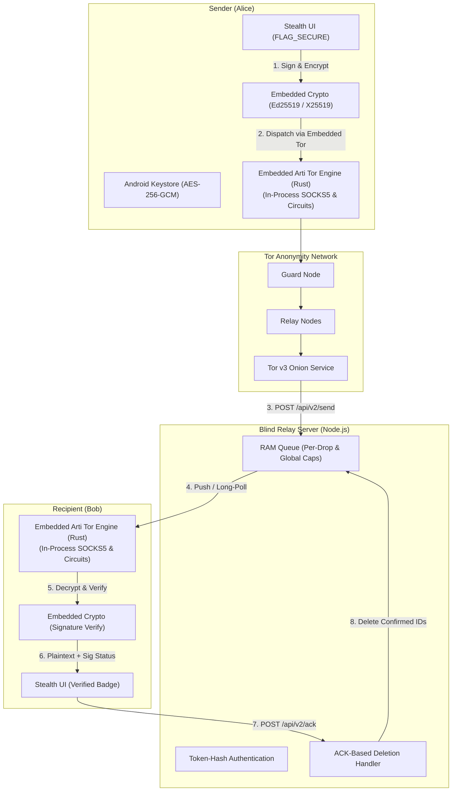
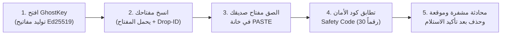

# GHOSTKEY // E2EE Messaging Suite (v2.3.0)

> **End-to-End Encrypted • Embedded Tor (Arti Rust Engine) • Ed25519/X25519 • Blind Dead-Drop Relay • 15MB Media • Opus PTT Voice**

---

## 🎯 Overview

**GhostKey** is an end-to-end encrypted messaging suite designed to resist network eavesdropping, traffic inspection, and hostile relay infrastructure. It pairs standard OpenPGP cryptography (Ed25519 + X25519) with an **Embedded Tor Onion Routing Engine (Arti in Rust)** to minimize metadata exposure to ISPs and intermediate relays without requiring any external apps like Orbot.

> [!NOTE]
> **GhostKey v2.3.0 Updates:** Features the embedded **Arti Tor Engine** (The Tor Project's official Rust implementation) running completely in-process, eliminating the need for Orbot. Also features end-to-end encrypted Push-to-Talk (PTT) voice notes using native Opus encoding (`.ogg`), zero disk footprint RAM-only audio streaming, clean bubble rendering, and full anti-forensics memory wipe.

---

## 🛡️ Architecture & Threat Model



### Core Security Properties

1. **Transport Protection via Embedded Tor Engine (Arti in Rust):**
   * Tor runs in-process inside the application using The Tor Project's official Rust implementation (**Arti**).
   * **Zero External Dependencies:** No need to install or run Orbot or third-party VPN apps; onion routing is 100% self-contained.
   * Local DNS leaks for `.onion` addresses are completely eliminated via in-memory stream routing.
   * ISPs only observe encrypted TLS connections to Tor Entry Guards, hiding destination `.onion` services.
2. **Modern Cryptographic Primitives:**
   * Embedded Bouncy Castle 1.78 engine (Android) and OpenPGP.js v6 (Web) — **no external apps required**.
   * Keys: **Ed25519** (sign/certify primary key) + **X25519** (encryption subkey).
   * **Sign-then-Encrypt:** Payloads are signed with the sender's private key before being wrapped in the recipient's encryption envelope. The relay cannot see who signed a message.
3. **Encrypted Push-to-Talk (PTT) Voice Notes (Opus):**
   * Encoded using native **Opus** (`.ogg`) at 32 kbps / 48 kHz for human voice clarity and lightweight payloads over Tor.
   * **Zero Disk Footprint:** Immediate temporary file shredding (zero-overwrite on disk); playback streams directly from volatile RAM (`MediaDataSource`) with zero disk writes.
4. **Blind Dead-Drop Relay (Protocol v2):**
   * Mailboxes use random 32-byte hex `dropId`s and secret 32-byte hex `readToken`s.
   * The server only stores `SHA-256(readToken)` in volatile RAM. Senders only need the `dropId`.
   * **ACK-Based Deletion:** Messages remain queued in memory until the recipient explicitly acknowledges receipt via `/api/v2/ack` or WebSocket ACK, preventing data loss on unstable circuits.
5. **Traffic Analysis Mitigation:**
   * Messages are padded using fixed bucket sizes (512 B for small messages, 16 KB for large messages) with cryptographically random filler to mask raw message lengths.
6. **Local Anti-Forensics & Storage Security:**
   * **Identity Persistence:** Private keys and peer configuration can be saved locally, encrypted with **AES-256-GCM** using keys backed by the **Android Keystore** (hardware TEE/StrongBox where available).
   * **Ephemeral Mode:** Toggle to run strictly in RAM without writing any identity data to disk.
   * **Panic Wipe & Burn Identity:** Destroys local Keystore aliases, purges audio buffers, deletes encrypted files, closes active sockets, and terminates memory.
   * **`FLAG_SECURE`:** Enforced on Android to block screenshots, video capture, and recent-app previews.

---

## 📂 Repository Structure

```text
├── server/                 # Blind Relay Server (Node.js + WebSockets)
│   ├── server.js           # Ephemeral, zero-log in-memory relay (v2 protocol)
│   ├── public/             # Static web companion (Opus PTT, zero CDNs, XSS-hardened)
│   ├── test/               # Node.js test suite (crypto, relay, web-e2e)
│   ├── torrc               # Tor v3 Onion Service configuration template
│   └── package.json
│
├── rust/                   # Embedded Tor Engine (Arti in Rust)
│   └── arti-mobile/        # In-process Tor client, SOCKS5 proxy & onion routing
│       ├── Cargo.toml      # arti-client (rustls + onion-service-client)
│       └── src/lib.rs      # JNI bridge for Android
│
├── android/                # Native Android Application (Kotlin + Jetpack Compose)
│   ├── app/src/main/java/com/ghostkey/app/
│   │   ├── MainActivity.kt # Streamlined Entry point, Lifecycle & State coordination
│   │   ├── audio/          # AudioRecorderManager (Opus), AudioPlayerManager (RAM-only)
│   │   ├── crypto/         # StandalonePgpEngine (Ed25519/X25519 Keyring Cache), WireFormat
│   │   ├── data/           # ChatMessage (@Immutable), SecureStore (Keystore AES-256-GCM)
│   │   ├── net/            # ArtiTorManager (Embedded Rust Tor), TorRelayClient
│   │   ├── service/        # Stealth Foreground Service (Neutral Sync Service)
│   │   └── ui/             # Modular Jetpack Compose UI
│   │       ├── components/ # AudioBubble, KeyBar, MessageBubble, StatusBadges
│   │       ├── dialogs/    # KeyDialogs, SettingsDialog
│   │       └── screens/    # LockedScreen
│   ├── build.gradle.kts
│   └── AndroidManifest.xml
│
├── web-client/             # React Companion Client (Protocol v2)
│   ├── src/                # Vite + React + OpenPGP.js
│   └── package.json
│
├── docs/                   # Cryptographic Architecture & Threat Model
│   └── ARCHITECTURE.md
│
├── start-all.bat           # Windows launcher (Local Relay + Web Client)
└── start-all.ps1           # PowerShell launcher
```

---

## 🚀 Quick Start Guide

### 1. Running the Blind Relay Server (Local or Tor)
```bash
cd server
npm install
npm test    # Runs 30 automated unit & integration tests
npm start   # Binds to 127.0.0.1:8765 by default
```
To run as a Tor Hidden Service:
```bash
tor -f torrc
# Hostname will be generated in ./hidden_service/hostname
```

### 2. Running the Web Client
```bash
cd web-client
npm install
npm run dev
# Opens at http://localhost:5173
```

### 3. Building the Android Application
```bash
cd android
./gradlew assembleDebug
# Output APK: android/app/build/outputs/apk/debug/app-debug.apk
```

---

## 📱 Mobile Step-by-Step Guide (دليل التشغيل الكامل على الهواتف)

### 🧩 المتطلبات:
1. **تطبيق GhostKey APK:** قم بتحميل أحدث إصدار من صفحة [GitHub Releases](https://github.com/ahmed-elbasyony123/Anti-jail/releases).
2. **لا يتطلب أي تطبيقات خارجية (Zero Config):** محرك **Tor Arti (Rust)** مدمج ذاتياً داخل التطبيق، ويقوم بإنشاء دوائر البصل والاتصال تلقائياً بدون الحاجة لتثبيت Orbot أو أي VPN (تطبيق Orbot أصبح خياراً احتياطياً فقط).
3. **محرك التشفير مدمج بالكامل (Bouncy Castle Ed25519/X25519):** التشفير والتوقيع يتم محلياً دون أي اعتماديات خارجية.

---

### 🛠️ خطوات الاستخدام:



#### الخطوة 1: تشغيل التطبيق ونسخ المفتاح 🔑
* عند أول تشغيل، يولد التطبيق مفاتيح **Ed25519/X25519** ورقم صندوق عشوائي (`dropId`) ورمز قراءة سري (`readToken`).
* اضغط على **COPY KEY** لمشاركة مفتاحك العام مع الطرف الآخر (المفتاح يحمل عنوان الـ Drop-ID تلقائياً).

#### الخطوة 2: لصق مفتاح الطرف الآخر 🤝
* اضغط على شريط المفاتيح أو أيقونة الدرع في الأعلى.
* الصق مفتاح صديقك واضغط **SAVE KEY**. سيتم التعرف تلقائياً على المفتاح وصندوق الاستلام الخاص به.

#### الخطوة 3: مطابقة كود الأمان (Safety Code) 🛡️
* افتح **Verify Safety Code** وقارن الأرقام الـ 30 مع صديقك عبر وسيلة اتصال موثوقة للتأكد من عدم وجود طرف ثالث (MITM).

#### الخطوة 4: التراسل الآمن 💬
* الرسائل مشفرة وموقعة وتظهر شارة **VERIFIED** للتأكيد على هوية المرسل.
* يتم حذف الرسائل من ذاكرة السيرفر المؤقتة بمجرد وصول تأكيد استلام (ACK) من جهاز المستلم.

#### زر الطوارئ (Emergency Panic Wipe) 🔥
* ضغطة واحدة على زر سلة المهملات/الحرق تمسح المفاتيح المخزنة ومفاتيح Android Keystore والرسائل من الذاكرة وتغلق التطبيق فوراً.

---

## 🔍 Security Audit Status & Known Limitations

| Component | Status | Details |
| :--- | :--- | :--- |
| **Transport Anonymity** | ✅ Implemented | Tor v3 Onion Routing with remote SOCKS5 DNS resolution. |
| **Cryptography** | ✅ Hardened | Ed25519 + X25519 (OpenPGP v4), signed-then-encrypted payloads. |
| **Relay Security** | ✅ Hardened | Random drop IDs, hashed read-tokens, ACK deletion, strict DoS limits, traversal-safe static file serving. |
| **Local Storage** | ✅ Hardened | AndroidKeyStore AES-256-GCM encrypted persistence; optional Ephemeral mode. |
| **Forward Secrecy** | ⚠️ Partial | Messages are encrypted using OpenPGP asymmetric subkeys (no per-message Double Ratchet). |
| **Relay Metadata** | ⚠️ Notice | Relay operators cannot read content, but can observe packet timing, payload sizes, and drop activity. |
| **Deployment Testing** | ⚠️ In Progress | Automated test suite passes (30/30). Live physical multi-device Tor testing is ongoing. |

---

## 📜 License
MIT License.
