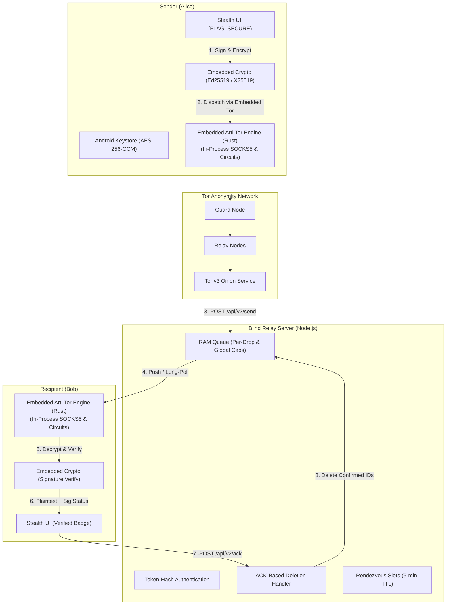
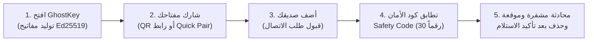

# GHOSTKEY // E2EE Messaging Suite (v3.0.1)

> **End-to-End Encrypted • Embedded Tor (Arti Rust Engine) • Ed25519/X25519 • AES-256-GCM Groups • Blind Dead-Drop Relay • Quick Pair Links & QR Pairing • BLE Mesh & Wi-Fi Direct • Opus PTT Voice • Bilingual AR/EN**

---

## 🎯 Overview

**GhostKey** is an end-to-end encrypted messaging suite designed to resist network eavesdropping, traffic inspection, and hostile relay infrastructure. It pairs standard OpenPGP cryptography (Ed25519 + X25519) with an **Embedded Tor Onion Routing Engine (Arti in Rust)** to minimize metadata exposure without requiring any external apps.

> [!NOTE]
> **What's New in v3.0.1:**
> - **Quick Pair via Invite Links:** Share a 5-minute burn-after-reading invite link (`#pair=XXXXX-XXXXX`) or manual code. The relay never sees the code (zero-knowledge via URL fragment). Receiver sees Accept/Decline before adding the contact.
> - **Signed Contact Requests:** Both sides exchange cryptographically signed `contact_request` messages so each party explicitly approves pairing.
> - **Deep Link Support:** `ghostkey://pair?c=` and `*.onion` HTTP/S links open directly in the app.
> - **Arabic RTL Auto-Detection:** Chat bubbles and input fields detect text direction automatically (Arabic RTL / English LTR).
> - **CI/CD Signed Releases:** APKs are signed with a stable release keystore via GitHub Secrets — updates install over previous versions without data loss.
> - **Auto-Deploy Relay:** Server code auto-deploys to the production Tor onion host on every push to `main`.
> - **39 Server Tests** covering relay protocol, crypto, web console, and rendezvous pairing end-to-end.

---

## 🛡️ Architecture & Threat Model



### Core Security Properties

1. **Transport Protection via Embedded Tor Engine (Arti in Rust):**
   * Tor runs in-process using The Tor Project's official Rust implementation (**Arti**).
   * **Zero External Dependencies:** No Orbot, no VPN — onion routing is 100% self-contained.
   * Local DNS leaks for `.onion` addresses are completely eliminated via in-memory stream routing.

2. **Modern Cryptographic Primitives:**
   * Embedded Bouncy Castle 1.78 engine (Android) and OpenPGP.js v6 (Web).
   * Keys: **Ed25519** (sign/certify primary key) + **X25519** (encryption subkey).
   * **Sign-then-Encrypt:** Payloads are signed before wrapping in the recipient's encryption envelope.

3. **Encrypted Push-to-Talk (PTT) Voice Notes (Opus):**
   * Native **Opus** (`.ogg`) at 32 kbps / 48 kHz for clarity over Tor.
   * **Zero Disk Footprint:** Immediate temporary file shredding; playback streams from volatile RAM.

4. **Blind Dead-Drop Relay (Protocol v2):**
   * Mailboxes use random 32-byte hex `dropId`s and secret 32-byte hex `readToken`s.
   * Server stores `SHA-256(readToken)` in volatile RAM only. Senders need only the `dropId`.
   * **ACK-Based Deletion:** Messages remain until recipient acknowledges receipt.

5. **Quick Pair Rendezvous (Zero-Knowledge):**
   * 10-character invite code from unambiguous alphabet (`23456789ABCDEFGHJKLMNPQRSTUVWXYZ`).
   * Slot ID derived as `SHA-256("gk-rv-id-v1:" + code)`; encryption via `PBKDF2 → AES-256-GCM`.
   * Relay sees only the hash, never the code or its content. Slots burn after one claim (5-min TTL).

6. **Traffic Analysis Mitigation:**
   * Fixed bucket padding (512 B / 16 KB) with cryptographically random filler.

7. **Local Anti-Forensics & Storage Security:**
   * **AES-256-GCM** encrypted persistence backed by **Android Keystore** (hardware TEE/StrongBox).
   * **Ephemeral Mode:** Run strictly in RAM without writing identity to disk.
   * **Panic Wipe & Burn Identity:** Destroys keys, purges buffers, closes sockets, terminates.
   * **Duress PIN:** Separate PIN that silently wipes everything when entered at the lock screen.
   * **`FLAG_SECURE`:** Blocks screenshots, video capture, and recent-app previews.

---

## 📂 Repository Structure

```text
├── .github/workflows/
│   ├── build-apk.yml       # CI: Build, test, sign & release APK (GitHub Actions)
│   └── deploy-server.yml   # CD: Auto-deploy relay to onion host on push to main
│
├── server/                  # Blind Relay Server (Node.js + WebSockets)
│   ├── server.js            # Ephemeral, zero-log in-memory relay (v2 protocol)
│   ├── lib/
│   │   ├── config.js        # Tunable limits (drops, TTL, rate limits, rendezvous)
│   │   ├── httpRoutes.js    # REST API: send, inbox, ack, rendezvous, static files
│   │   ├── mailboxStore.js  # RAM mailbox store with GC & rendezvous slots
│   │   └── wsHub.js         # WebSocket hub: subscribe, push, ACK, heartbeat
│   ├── public/              # Web Console (OpenPGP.js, zero CDNs, XSS-hardened)
│   │   ├── index.html       # Web UI: chat, Quick Pair modal, contact requests banner
│   │   ├── app.js           # UI logic, rendezvous flow, contact_request handling
│   │   ├── app.css          # Dark/light theme styles
│   │   ├── ghostkey-core.mjs   # Crypto: OpenPGP, Wire v2, rendezvous seal/open
│   │   ├── ghostkey-ui.mjs     # Rendering: chat bubbles, attachments, signatures
│   │   └── ghostkey-i18n.mjs   # Bilingual strings (EN + AR)
│   ├── test/                # 39 automated tests (relay, crypto, UI, e2e)
│   ├── torrc                # Tor v3 Onion Service config template
│   └── package.json
│
├── rust/                    # Embedded Tor Engine (Arti in Rust)
│   └── arti-mobile/
│       ├── Cargo.toml       # arti-client (rustls + onion-service-client)
│       └── src/lib.rs       # JNI bridge: bootstrap, streams, shutdown
│
├── android/                 # Native Android App (Kotlin + Jetpack Compose)
│   ├── app/src/main/java/com/ghostkey/app/
│   │   ├── MainActivity.kt         # Entry, FLAG_SECURE, deep links, permissions
│   │   ├── MainViewModel.kt        # StateFlow UI state, Tor/LAN coordination
│   │   ├── audio/                   # Opus recording & RAM-only playback
│   │   ├── crypto/
│   │   │   ├── StandalonePgpEngine.kt  # Ed25519/X25519 OpenPGP (LRU cache)
│   │   │   ├── GroupCrypto.kt          # AES-256-GCM group encryption with AAD
│   │   │   ├── WireFormat.kt          # Wire protocol v2 (all message types)
│   │   │   ├── InPersonPairing.kt      # QR code generation/scanning + SAS
│   │   │   └── RendezvousPairing.kt    # Quick Pair link/code crypto
│   │   ├── data/
│   │   │   ├── MessagingService.kt     # Send/receive, contact_request interception
│   │   │   ├── IdentityRepository.kt   # Prefs, key persistence, settings
│   │   │   ├── SecureStore.kt          # AES-256-GCM via Android Keystore
│   │   │   ├── ContactRequest.kt       # Pending pair request data class
│   │   │   └── MessageContent.kt       # Typed sealed interface for all content
│   │   ├── net/
│   │   │   ├── ArtiTorManager.kt       # Arti Rust engine lifecycle (JNI)
│   │   │   ├── TorRelayClient.kt       # HTTP + WebSocket relay client
│   │   │   ├── LocalLanMesh.kt         # Wi-Fi LAN peer discovery & messaging
│   │   │   └── mesh/                   # BLE Mesh engine + Wi-Fi Direct P2P
│   │   ├── media/                      # MediaSanitizer (strip EXIF, etc.)
│   │   ├── security/                   # PIN, Duress PIN, SecurityLockManager
│   │   ├── notify/                     # Push notifications (zero-leakage)
│   │   ├── service/                    # TorForegroundService
│   │   └── ui/
│   │       ├── screens/                # Compose screens: Chats, Chat, Settings, Profile, Lock, Onboarding
│   │       ├── dialogs/                # QuickPairDialog, PairingDialogs, GroupDialog, etc.
│   │       ├── components/             # MessageBubble, AudioBubble, AvatarView, NavigationIsland
│   │       ├── theme/                  # Material 3 dark/light theme
│   │       └── strings/Strings.kt      # Bilingual EN + AR strings
│   ├── app/src/test/                   # 5 Kotlin test suites (crypto, wire, mesh, utils, rendezvous)
│   └── build.gradle.kts               # Release signing + CI versionCode injection
│
├── docs/ARCHITECTURE.md     # Cryptographic architecture & threat model
├── start-all.bat            # Windows launcher (Local Relay + Web Console)
└── start-all.ps1            # PowerShell launcher
```

---

## 🚀 Quick Start Guide

### 1. Running the Blind Relay Server & Web Console

```bash
cd server
npm install
npm test    # Runs 39 automated unit, integration & e2e tests
npm start   # Binds to 127.0.0.1:8765 (serves API + Web Console)
```

To run as a Tor Hidden Service:
```bash
tor -f torrc
# Hostname will be generated in ./hidden_service/hostname
```

### 2. Building the Android Application

**From GitHub (recommended):** Download the latest signed APK from [GitHub Releases](https://github.com/ahmed-elbasyony123/GHOSTKEY/releases). Every release is automatically built, tested, and signed with a stable keystore — updates install over previous versions without data loss.

**From source:**
```bash
cd android
./gradlew assembleRelease
# Output: android/app/build/outputs/apk/release/app-release.apk
```

---

## 📱 Mobile Guide (دليل التشغيل الكامل)

### 🧩 المتطلبات:
1. **تطبيق GhostKey APK:** حمّل أحدث إصدار من [GitHub Releases](https://github.com/ahmed-elbasyony123/GHOSTKEY/releases).
2. **لا يتطلب أي تطبيقات خارجية:** محرك **Tor Arti (Rust)** مدمج ذاتياً — لا حاجة لتثبيت Orbot أو VPN.
3. **محرك التشفير مدمج بالكامل (Bouncy Castle Ed25519/X25519).**

---

### 🛠️ خطوات الاستخدام:



#### الخطوة 1: تشغيل التطبيق وإنشاء الهوية 🔑
* عند أول تشغيل، يولد التطبيق مفاتيح **Ed25519/X25519** ورقم صندوق عشوائي (`dropId`) ورمز قراءة سري (`readToken`).
* يمكنك اختيار حفظ هويتك محلياً (مشفرة بـ AES-256-GCM) أو العمل في الوضع المؤقت (RAM فقط).
* أدخل عنوان الـ Relay الخاص بك (عنوان `.onion`) واختر اسمك المستعار.

#### الخطوة 2: مشاركة المفتاح وإضافة جهات الاتصال 🤝
لديك 3 طرق:
* **Quick Pair (الأسرع):** اضغط زر Quick Pair لتوليد رابط دعوة صالح لـ 5 دقائق. شاركه مع صديقك — عند فتحه يرى صديقك Accept/Decline.
* **In-Person QR (الأأمن):** امسح كود QR بالكاميرا مباشرة وقارن كود الأمان.
* **لصق المفتاح العام:** انسخ المفتاح يدوياً واضغط "New Direct Chat".

#### الخطوة 3: مطابقة كود الأمان (Safety Code) 🛡️
* افتح أيقونة الدرع داخل المحادثة وقارن الأرقام الـ 30 مع صديقك (مقاومة MITM).

#### الخطوة 4: التراسل الآمن 💬
* الرسائل والصوتيات والمرفقات مشفرة وموقعة.
* الرسائل الجماعية المشفرة (AES-256-GCM) والرسائل المختفية (Disappearing Messages) مدعومة.
* المرفقات حتى 15 MB (صور، ملفات، صوتيات Opus).
* يتم حذف الرسائل من السيرفر بمجرد وصول تأكيد استلام (ACK).

#### زر الطوارئ (Emergency Panic Wipe) 🔥
* ضغطة واحدة على **PANIC WIPE** تمسح كل شيء: المفاتيح، بيانات Arti، الرسائل من الذاكرة، وتغلق التطبيق فوراً.
* أو أدخل رمز الإكراه (**Duress PIN**) عند شاشة القفل لمسح صامت.

---

## ⚙️ CI/CD Pipeline

### APK Build & Release (GitHub Actions)
Every push to `main` automatically:
1. Checks out code and sets up JDK 17 + Rust toolchain
2. Builds Arti Tor engine (Rust → `libarti_mobile.so` for arm64-v8a, cached)
3. Runs Kotlin unit tests (5 test suites: crypto, wire format, mesh, rendezvous, utils)
4. Decodes the release keystore from GitHub Secrets
5. Builds R8-shrunk release APK signed with a **stable RSA-4096 keystore**
6. Publishes a new GitHub Release with auto-incrementing `versionCode`

### Server Auto-Deploy
Every push to `main` that changes `server/`:
1. Runs 39 server tests (relay, crypto, web console, e2e)
2. Syncs files to the production Tor onion host via SSH/rsync
3. Installs production dependencies and restarts the relay service
4. Verifies the relay is healthy (`/api/v2/ping`)

---

## 🌐 Wire Protocol v2

All messages use a unified JSON envelope with version tagging and random padding:

| Type | Description |
|:---|:---|
| `text` | Encrypted text message with optional TTL (disappearing) |
| `media` | Image, file, or audio attachment (Base64, up to 15 MB raw) |
| `group_invite` | AES-256-GCM group invitation with cryptographic validation |
| `group_control` | Key rotation (`key_rotate`) or leave notifications |
| `introduction` | Third-party contact introduction with safety code |
| `profile_update` | Alias and avatar changes (bounded to 64 KB) |
| `clear_chat` | Bilateral chat wipe for both sender and receiver |
| `contact_request` | Signed pairing request with public key, alias, dropId, fingerprint |

---

## 🔀 Network Transports

| Transport | Range | Requirement |
|:---|:---|:---|
| **Tor Relay** (Arti Rust) | Global | Internet connection; in-process SOCKS5 |
| **Wi-Fi LAN Mesh** | Local network | Same Wi-Fi; mDNS/NSD discovery |
| **BLE Mesh** | ~100m radius | Bluetooth LE; multi-hop relay |
| **Wi-Fi Direct P2P** | ~200m | No router needed; direct peer link |

All transports use the same Wire v2 format and OpenPGP encryption.

---

## 🔍 Security Audit Status & Known Limitations

| Component | Status | Details |
|:---|:---|:---|
| **Transport Anonymity** | ✅ Implemented | Tor v3 Onion Routing with remote SOCKS5 DNS resolution. |
| **Cryptography** | ✅ Hardened | Ed25519 + X25519, SEIPD/MDC integrity checks, AES-only ciphers, bounded LRU caches. |
| **Relay Security** | ✅ Hardened | Random drop IDs, hashed read-tokens, ACK deletion, DoS limits, CSRF/CSWSH protection, Slowloris timeouts. |
| **Quick Pair** | ✅ Implemented | Zero-knowledge rendezvous, PBKDF2 → AES-256-GCM, burn-after-reading, signed contact_request. |
| **Local Storage** | ✅ Hardened | AndroidKeyStore AES-256-GCM, PBKDF2 PIN hashing, Duress PIN, optional Ephemeral mode. |
| **Forward Secrecy** | ⚠️ Partial | OpenPGP asymmetric subkeys; no per-message Double Ratchet. |
| **Relay Metadata** | ⚠️ Notice | Relay operators cannot read content, but can observe timing, payload sizes, and drop activity. |
| **Testing** | ✅ 39/39 Server + 5 Android test suites | Automated CI on every push. |

---

## 📜 License

MIT License.
