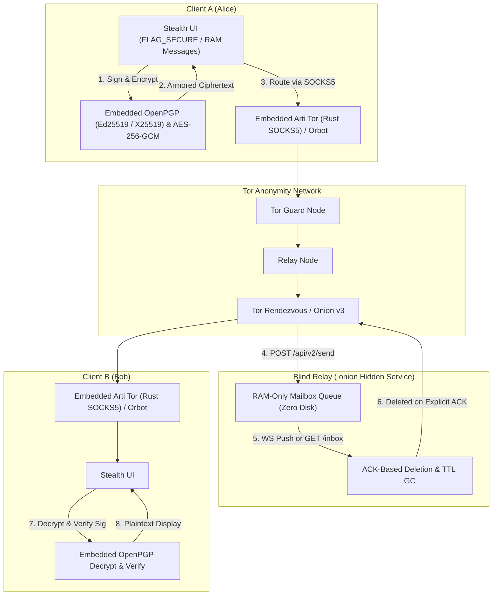

# GhostKey Security & Cryptographic Architecture (v2.8.0)

## 1. Threat Model & Adversary Capabilities

GhostKey is engineered against an active adversary with comprehensive network oversight, including:
- **Internet Service Providers (ISPs)** inspecting packets, capturing NetFlow/IPFIX logs, and executing Deep Packet Inspection (DPI).
- **Adversarial Network Observers / Telecom Authorities** attempting metadata correlation (who is talking to whom, timestamps, packet sizes).
- **Compromised or Hostile Relay Infrastructure**: The relay sees only random 32-byte hex `dropId`s and OpenPGP / AES-256-GCM ciphertexts, with zero decryptable plaintext.
- **Physical Device Seizure / Forensics**: Mitigated via `FLAG_SECURE`, volatile RAM-only message storage, Hardware-backed AndroidKeyStore identity encryption (or Ephemeral RAM-only mode), App/Duress PINs, and one-touch Panic Wipe.

---

## 2. The Four Pillars of Untraceability

### Pillar 1: Transport Anonymity via Embedded Arti Tor & Onion Services (v3)
* Standard apps make direct TCP/TLS connections to centralized servers, exposing the target IP address and server SNI in the TLS ClientHello to the ISP.
* GhostKey embeds The Tor Project's **Arti** engine (compiled to `libarti_mobile.so` via Rust/JNI) with Orbot SOCKS5 fallback, preventing clearnet DNS leaks for `.onion` hosts.
* **Server Anonymity:** When the relay server is deployed with `tor -f torrc` (`SocksPort 0`, `HiddenServicePoWDefensesEnabled 1`), its true IP and location are hidden behind a v3 onion service.

### Pillar 2: Embedded OpenPGP (Ed25519 + X25519) & AES-256-GCM Groups
* **Zero External Key Apps:** Key generation, sign-then-encrypt, and verification run in-process via Bouncy Castle 1.78 (Android) and OpenPGP.js v6 (Web Console).
* **Mandatory Integrity & Signature Checks:** Enforces SEIPD/MDC integrity protection, `SUBKEY_BINDING` + `SIGN_DATA` verification, SHA-256/384/512 signatures, and AES-only symmetric ciphers.
* **Groups:** Dedicated random group mailboxes encrypted with per-group 256-bit AES-GCM keys shared via pairwise E2EE invites.

### Pillar 3: Blind Dead-Drop & Authenticated Protocol v2
* Mailboxes use cryptographically bound random 32-byte hex credentials:
  `dropId = SHA-256("drop:" + readToken)`
* **RAM-Only Architecture:** Messages reside strictly in a bounded in-memory `Map` with per-drop rate/queue caps and global memory limits.
* **ACK-Based Deletion:** Messages stay queued across unstable Tor circuits until the recipient explicitly sends `POST /api/v2/ack` or WebSocket `ACK`, or until TTL expiration.

### Pillar 4: Anti-Forensics & Client Hardening
* **`FLAG_SECURE`:** Blocks screenshots, screen recording, and recent-app thumbnails.
* **Zero Message Persistence:** Messages and decrypted media live solely in volatile RAM; armored ciphertexts are stripped from RAM upon decryption and audio buffers are zeroed on wipe/expiration.
* **Bucket Traffic Padding:** Plaintexts are padded to 512 B or 16 KB buckets with random base64url filler (`WireFormat.kt` / `ghostkey-core.mjs`).
* **Duress PIN & Panic Wipe:** Zeroes RAM buffers, wipes `SecureStore` & AndroidKeyStore aliases, purges Arti state/cache, clears clipboard, and terminates the process.
