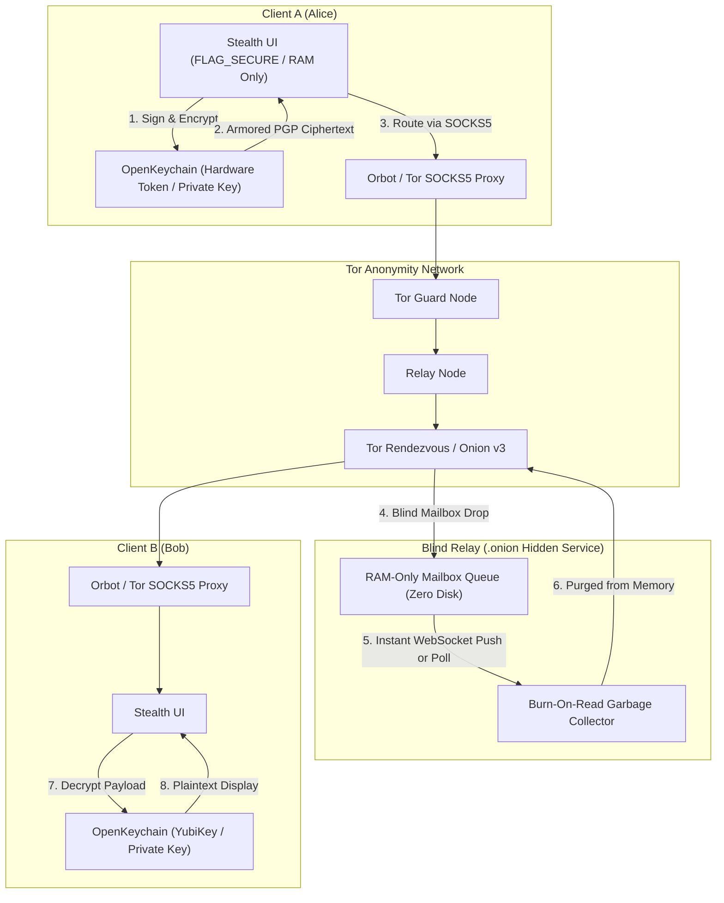

# GhostKey Security & Cryptographic Architecture

## 1. Threat Model & Adversary Capabilities

GhostKey is engineered against an active adversary with comprehensive network oversight, including:
- **Internet Service Providers (ISPs)** inspecting packets, capturing NetFlow/IPFIX logs, and executing Deep Packet Inspection (DPI).
- **Adversarial Network Observers / Telecom Authorities** attempting metadata correlation (who is talking to whom, timestamps, packet sizes).
- **Compromised or Hostile Relay Infrastructure**: Even if the message relay server is seized by a government or hostile actor, it possesses zero decryptable data and zero metadata.
- **Physical Device Seizure / Forensics**: Mitigated via `FLAG_SECURE`, volatile memory-only storage (no local SQLite or unencrypted disk cache), and one-touch Panic Wiping.

---

## 2. The Four Pillars of Untraceability

### Pillar 1: Transport Anonymity via Tor Onion Services (v3)
* Standard apps make direct TCP/TLS connections to centralized servers, exposing the target IP address and server SNI in the TLS ClientHello to the ISP.
* GhostKey routes all traffic through **Tor Onion Services (v3)** via SOCKS5 (`127.0.0.1:9050` / Orbot).
* **What your ISP sees:** Only encrypted, constant-size Tor cell traffic destined to an Entry Guard node. The ISP cannot determine the destination server, cannot read the `.onion` address, and cannot distinguish messaging traffic from normal Tor web browsing.
* **Server Anonymity:** When the relay server is deployed with `tor -f torrc`, its true IP and location are unknown even to the clients.

### Pillar 2: OpenKeychain Key Isolation & OpenPGP
* **Zero Private Key Exposure:** The messaging application never stores, reads, or caches private PGP keys. All private key operations occur inside the sandboxed **OpenKeychain** Android application.
* **Hardware Security Token Support:** Users can store private keys on a physical **YubiKey** or **Nitrokey**. Decrypting a message requires physical NFC tap or USB authorization.
* **Algorithm Standard:** OpenPGP (RFC 4880 / RFC 9580) using Elliptic Curve Cryptography (`Curve25519` / `Ed25519`) or 4096-bit RSA.

### Pillar 3: Blind Dead-Drop & Zero-Metadata Relay
* The relay server does not know who the sender is or who the recipient is.
* Mailboxes are addressed by a cryptographic hash:
  $$\text{MailboxHash} = \text{SHA-256}(\text{RecipientFingerprint} \parallel \text{Salt})$$
* **RAM-Only Architecture:** The server never writes to SQLite, MySQL, or files. Messages reside in an ephemeral memory Map.
* **Burn-On-Read:** The instant a message is delivered to a connected WebSocket or fetched via HTTP, it is permanently deleted from memory.
* **TTL Eviction:** Messages unread after 1 hour are evicted by the internal garbage collector.

### Pillar 4: Anti-Forensics & Client Hardening
* **`FLAG_SECURE`:** Enforced on the Android window. Blocks screen recording, screenshots, and prevents sensitive thumbnails from showing in the Android App Switcher.
* **Zero Disk Footprint:** Plaintexts are held only in volatile state memory. No unencrypted local database.
* **Stealth Noise Padding:** Messages are padded with random noise bytes before encryption to foil packet-size traffic analysis.
* **Emergency Panic Wipe:** A single tap destroys all in-memory keys, clears state arrays, unbinds services, and terminates the application process immediately.
